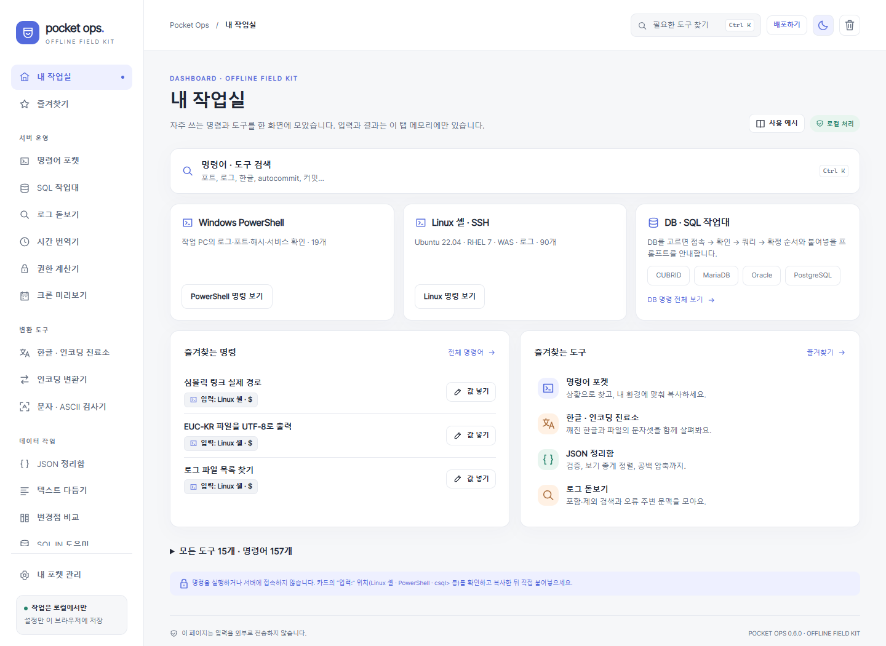

# Pocket Ops

Windows 작업 PC와 휴대폰에서 보는 한국어 오프라인 공구함입니다. **`pocket-ops.html` 파일 하나**, 도구 15개, 명령어 157개. 별도 폴더·설치·서버·인터넷·로그인 없이 사용합니다.

**[Pocket Ops 다운로드](https://ops.jjunybox.com/)** · [최신 단일 HTML](https://ops.jjunybox.com/pocket-ops.html) · [망간전송용 ZIP](https://ops.jjunybox.com/pocket-ops.zip) · [SHA-256](https://ops.jjunybox.com/SHA256SUMS.txt)

버전이 바뀌어도 위 주소로 최신 정식 릴리스의 파일을 받을 수 있습니다. [GitHub 릴리스](https://github.com/seamoon23/pocket-ops/releases/latest) · [상세 사용법](README_KO.md) · [보안 검토](SECURITY_REVIEW.md) · [검증 결과](TEST_REPORT.md)

1. 위 **단일 HTML 받기**로 파일을 저장합니다. ZIP은 안내문을 함께 받을 때만 필요합니다.
2. PC: 탐색기 → `pocket-ops.html` 우클릭 → **연결 프로그램 → 허용된 Edge/Chrome**. 기관 반입은 승인된 절차를 따릅니다.
3. 갤럭시: **앱스 → 내 파일 → 다운로드 → pocket-ops.html** → 표시되는 허용된 브라우저/HTML 뷰어. 출발 전에 네트워크를 끄고 다시 열어 보세요. 파일 연결 앱과 지원 기능은 기기마다 다릅니다.
4. 왼쪽 메뉴(휴대폰은 상단 **메뉴**) → **명령어 포켓 → Windows / Linux / DB → 확인·복사**, 또는 도구 → 입력 → 실행 → 결과 복사.

JavaScript를 실행하지 않는 HTML 뷰어에는 같은 파일 안의 **읽기 전용 명령어 참고**가 표시됩니다. 이 모드에서는 검색·즐겨찾기·변환·자동 복사를 사용할 수 없습니다. HTML 자체를 표시하지 않는 뷰어는 지원하지 않습니다.

- 메뉴 → 명령어 포켓 → DB → 원하는 DB → CRUD 프리셋 → 쿼리 정렬로 열기 → SQL 수정 → 복사. INSERT/UPDATE/DELETE는 최종 SQL을 확인한 뒤 복사
- 메뉴 → 서버 운영 → SQL 작업대에서 기본 SQL 한 문장 정렬·복사·UTF-8 SQL 저장
- JSON·텍스트·로그·SQL IN·인코딩·파일 해시 등 로컬 작업 도구
- Windows PowerShell 5.1, Ubuntu 22.04/RHEL 7 중심 명령어와 기본 도구 대안
- 도구·명령어 통합 즐겨찾기, 키보드 검색, 설정 백업
- 상단 **배포하기**로 현재 버전의 깨끗한 ZIP 저장. 업무 입력·개인 설정은 배포본에서 제외

서버 명령과 SQL을 실행하지 않습니다. 자동 업데이트·외부 통신 기능도 없습니다. 기관의 반입·브라우저 정책과 대상 서버 권한을 확인하세요. 보안 검토는 기관 승인이나 모든 환경의 동작 보증을 의미하지 않습니다.

개발 PC에서 PowerShell → 저장소 폴더를 열고 `python make_data.py`, `python build.py`를 순서대로 실행하면 HTML·ZIP·SHA-256 목록이 생성됩니다. 자세한 개발/시험 경로는 [AGENTS.md](AGENTS.md)에 있습니다.

GitHub → **Actions → Verify offline release**에서 변경마다 실행되는 Windows 검증 결과를 볼 수 있습니다. 개발용 검증 환경에서만 테스트 도구를 설치하며 오프라인 HTML에는 포함하지 않습니다.
